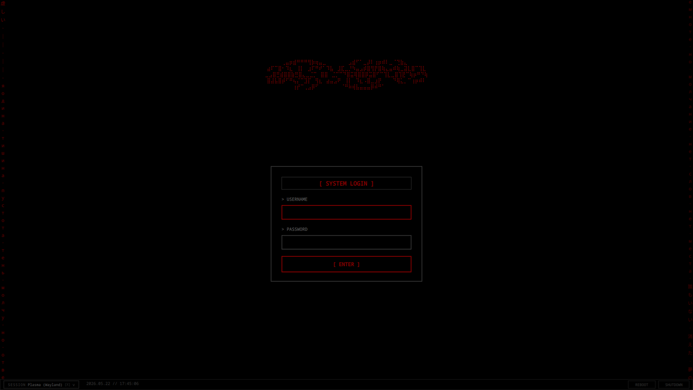

# ascii cybersigilist — SDDM theme

black screen. dark red text. the kind of login screen that looks like something you'd see on a terminal in a film where the protagonist is already too far gone to turn back.



## features

- braille-art logo in deep crimson (`#8B0000`)
- two single-character-wide scrolling columns on the screen edges — Russian and Japanese glyphs from loneliness poems, one descending left, one ascending right
- login box with monospace field labels, red-bordered focus states, `[ ENTER ]` button
- session picker popup with card layout — WAYLAND / X11 badges read from actual SDDM session model named roles, not name-sniffing. works with any installed session automatically (Sway, Plasma, Hyprland, i3, Openbox, GNOME, etc.)
- status bar: live clock, session switcher with `[W]`/`[X]` type pill, REBOOT and SHUTDOWN buttons
- Terminus font, hard corners, no rounding anywhere

## requirements

- SDDM 0.19+
- Qt 6
- Terminus font (falls back to system monospace)

## install

```bash
sudo cp -r terminal-red/ /usr/share/sddm/themes/
```

then in `/etc/sddm.conf` or `/etc/sddm.conf.d/*.conf`:

```ini
[Theme]
Current=terminal-red
```

## credits

original base theme by [Splicer Scorn](https://voidrane.nekoweb.org).  
extended by deadgirl (numbpill3d) — marquee animations, session detection rewrite, status bar improvements.

## license

CC-BY-SA 4.0
